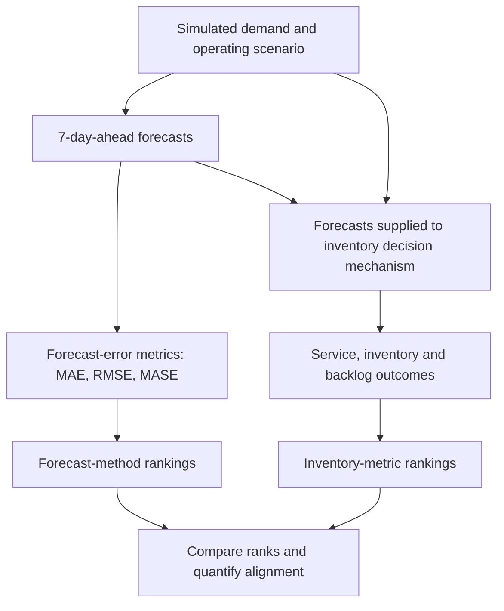

# From Forecast Accuracy to Inventory Decisions

**Evaluating forecast-to-decision alignment under normal and disrupted supply-chain conditions**

Master's thesis research project | Python · Time-series forecasting · Supply-chain simulation · Inventory analytics

**Research focus:** Does a forecasting method's rank by statistical accuracy correspond to its rank by downstream inventory outcomes? This project examines that relationship across operating scenarios and simulation horizons. It does **not** seek to declare one forecasting model universally best.

## The problem

Forecasting systems are often compared using prediction-error metrics. In an inventory system, however, a forecast is an input to a decision process: replenishment, transit, stock availability, backlog, and the operating environment shape what happens after a prediction is made. Better forecast accuracy and better inventory outcomes are related questions, but they are not the same outcome.

This study evaluates forecasting methods twice: first as predictors of demand, then by the inventory outcomes observed when their forecasts are used by a common downstream decision mechanism. The central object of analysis is the **alignment between the two ranking systems**, including the cases where they disagree.

## Research design at a glance

| Element | Design |
|---|---|
| Supply-chain setting | Synthetic, multi-echelon, FMCG-like network |
| Product scope | 50 stock-keeping units (SKUs) |
| Forecasting methods | Seasonal Naïve, Exponential Smoothing (ETS), LightGBM |
| Forecast horizon | 7 days |
| Operating scenarios | Normal, Demand Disruption, Supply Disruption, Combined Disruption |
| Simulation horizons | 2,000, 3,000, 5,000 and 7,300 days |
| Forecast-accuracy measures | MAE, RMSE and MASE (lower is better) |
| Decision outcomes | Service/fill rate, unfilled demand, destination inventory, network inventory and backlog measures |
| Main comparison | Metric-specific forecast ranks versus metric-specific inventory-outcome ranks |

The horizons are separate experiment configurations, not four independent statistical replications. The shorter-horizon experiments and the 7,300-day notebook also have implementation differences; see [the experiment protocol](docs/experiment_protocol.md) and [validation notes](docs/reproducibility_and_validation.md).

## Research workflow (conceptual)



This diagram summarizes the thesis design, not the automation completeness of the current short-horizon script; the joined alignment output remains a documented gap below. The workflow separates prediction quality from operational outcomes. Forecast metrics and inventory objectives are **not** collapsed into a weighted composite score. A high fill rate is desirable; lower unfilled demand and backlog are generally desirable; lower inventory is interpreted alongside service, rather than as an unqualified objective. The thesis does not construct monetary holding, ordering, or stockout costs and therefore does not claim cost savings or economic superiority.

## What the analysis examines

- **Forecast accuracy:** model-level MAE, RMSE and MASE, with item-level values aggregated using means and medians where the underlying result tables provide them.
- **Inventory outcomes:** fill rate, total unfilled demand, average destination inventory, average destination backlog, maximum destination backlog and average total network inventory as the primary operational measures. Maximum inventory, final backlog and shipment totals are treated as descriptive measures in the thesis framework.
- **Rank alignment:** rank difference, absolute rank difference, exact model-rank agreement and descriptive rank correlation. With only three forecasting methods, rank correlations are descriptive rather than strong inferential evidence.
- **Robustness and context:** whether the relationship varies by disruption scenario, simulation horizon and aggregation choice.

## Findings and evidential status

The thesis reports **limited rather than one-to-one ranking agreement** between forecast-accuracy ranks and inventory-decision ranks. This repository does not present a single blended agreement percentage, because the percentage depends on the alignment definition: complete-ordering agreement (all three models in the same order on a given metric) and model-level rank equality (a single model's forecast rank equals its inventory rank) are different estimands, and the six-primary-metric framework and the wider descriptive-metric framework give different results. Mean absolute rank differences were reported near one rank position. These are descriptive results, not inferential estimates.

**Important qualification:** this repository has not yet independently reproduced the complete alignment analysis end to end. Source-file audits found that the supplied 5,000-day inventory-outcome and inventory-ranking files are byte-for-byte duplicates of the 3,000-day counterparts. The 7,300-day notebook also contains failed Combined Disruption check cells alongside later passing assembly and inventory cells (see validation notes for the cell-level status). Consequently, those files do not independently validate the reported 5,000-day inventory evidence, and the cross-horizon summaries should not be presented as fully verified until the source outputs are reconciled. The known issues and protocol differences are documented in [Validation and reproducibility status](docs/reproducibility_and_validation.md).

This distinction is central to the project: results should be interpreted in light of how they were produced and checked, not only how they are presented.

## Repository map

```text
.
├── README.md
├── requirements.txt
├── .gitignore
├── .gitattributes
├── CITATION.cff
├── Supplychaingeo_item50.py
├── Supplychaingeo_item50_v2.py
├── thesis_short_horizon_experiments.py
├── notebooks/
│   ├── README.md
│   ├── thesis_7300day_notebook_organized_plain_text.ipynb
│   └── archive/
│       ├── README.md
│       └── thesis_working_notebook_7300_days.ipynb
└── docs/
    ├── README.md
    ├── experiment_protocol.md
    └── reproducibility_and_validation.md
```

### Main files

- **`Supplychaingeo_item50.py`** — base supply-chain simulation model, including the network, item and node structures, routing/allocation logic and day-level simulation.
- **`Supplychaingeo_item50_v2.py`** — extended simulation with disruption and scenario-control functionality. It imports the base module, so both Python modules must stay together in the repository root.
- **`thesis_short_horizon_experiments.py`** — runner for the 2,000-, 3,000- and 5,000-day configurations. It freezes a scenario's demand series for model comparisons, evaluates forecasts, runs the inventory experiments, and writes forecast summaries and inventory-metric rankings.
- **`notebooks/thesis_7300day_notebook_organized_plain_text.ipynb`** — the primary organized research notebook for the 7,300-day experiment. It records data checks, exploratory analyses, forecast experiments, inventory experiments and later result rechecks.
- **`docs/`** — protocol, repository navigation and the current verification limitations.

## Getting started

### 1. Create an environment and install dependencies

Python 3.9 or newer is the target for the short-horizon runner. The original 7,300-day notebook metadata references a Python 3.12 environment named `ISOMORPH`; an exact historical environment lock file is not included.

```bash
python -m venv .venv
```

Activate the environment, then run:

```bash
python -m pip install --upgrade pip
python -m pip install -r requirements.txt
```

### 2. Check Python syntax without launching experiments

```bash
python -m py_compile \
  Supplychaingeo_item50.py \
  Supplychaingeo_item50_v2.py \
  thesis_short_horizon_experiments.py
```

This is a syntax check only; it does not validate the simulation or reproduce thesis results.

### 3. Run a small configuration when ready

The following command starts the 2,000-day Normal scenario. It is an actual simulation run and may take time; it is **not** executed automatically when the repository is installed.

```bash
python thesis_short_horizon_experiments.py \
  --output-dir thesis_short_runs \
  --horizons 2000 \
  --scenarios normal
```

The runner writes generated outputs under the selected output directory, which is excluded from Git. See [the experiment protocol](docs/experiment_protocol.md) before running additional configurations.

## Reproducibility boundaries

This repository is a research-code and audit-trail package, **not yet a one-command reproduction of every thesis table**.

- The short-horizon runner produces forecast metrics and inventory rankings separately. It does not currently create a dedicated, joined forecast-rank-versus-inventory-rank alignment table.
- The 7,300-day notebook refers to local Windows paths under `D:\ISOMORPH\...` and expects simulation data/results that are not included here. It has not been re-executed in a clean environment as part of this package.
- The notebook contains three saved error cells in the Combined Disruption section (cells 93, 100, 103) alongside later passing assembly and inventory cells (104–106). The locked master table (cell 109) is hardcoded literals with no file reads and no programmatic link to the earlier cells, and its MASE values do not match any in-notebook calculation from the Combined file (see validation notes). Its saved outputs should not all be treated as authoritative without reconciliation.
- The 7,300-day Supply Disruption LightGBM procedure differs from the shorter-horizon procedure in refitting behavior and prediction clipping.
- A completed experiment run, a saved output, and an independently validated result are different statuses. Do not conflate them.

See [docs/reproducibility_and_validation.md](docs/reproducibility_and_validation.md) for detail. The complete joined alignment analysis and a clean, recorded end-to-end run are the main work needed before this repository can claim full computational reproducibility of the thesis results.

## Skills demonstrated

The work provides concrete examples of:

- time-series forecasting and lag/rolling-feature engineering;
- LightGBM and statistical exponential smoothing;
- stochastic multi-echelon supply-chain simulation;
- inventory service, backlog and stock measurement;
- metric-specific ranking and forecast-to-decision comparison;
- data validation, auditability and methodological qualification;
- Python, pandas, NumPy, scikit-learn, statsmodels, LightGBM and Jupyter.

## Research scope and limitations

The environment is synthetic, the model set is limited to three forecasting methods, the forecast horizon is fixed at seven days, and inventory performance is evaluated using separate operational measures rather than an explicit economic objective. Findings should be interpreted within those boundaries; they are not evidence of realized company savings or universal model superiority.

## Author

**Gokul Kanna Durairaj** · Master's thesis in Data Science – Business Analytics

[LinkedIn](https://www.linkedin.com/in/gokuldkanna/)
