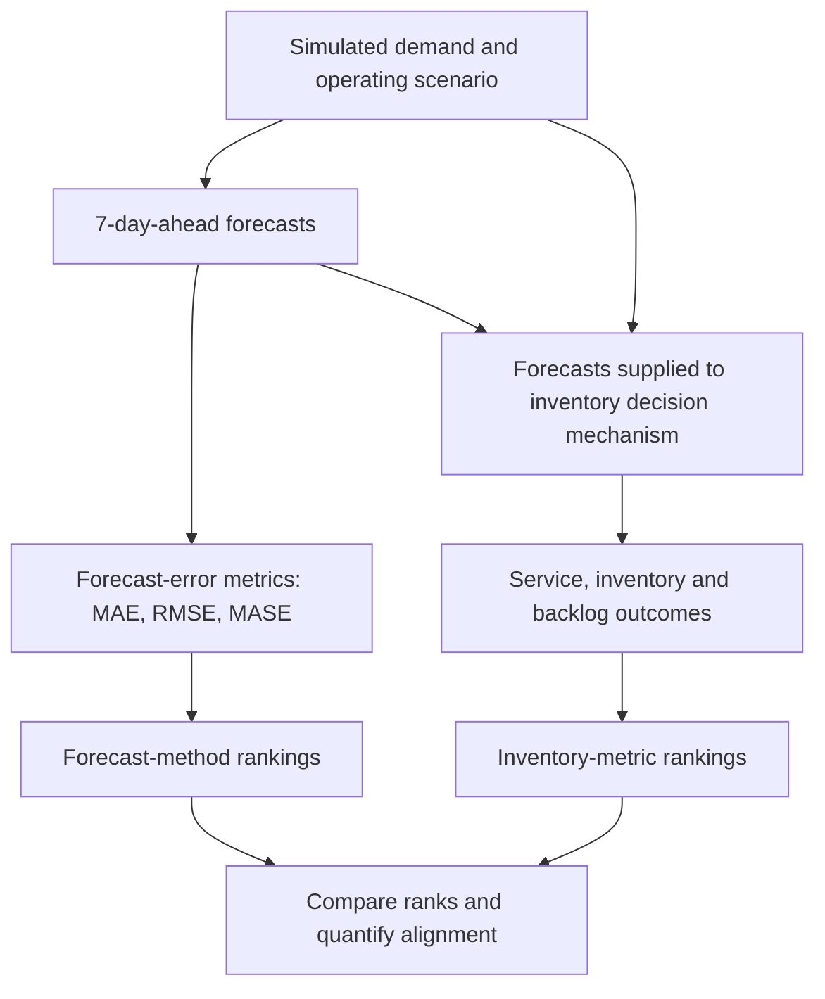

# From Forecast Accuracy to Inventory Decisions

**Evaluating forecast-to-decision alignment under normal and disrupted supply-chain conditions**

Master's thesis research project · Python · Time-series forecasting · Supply-chain simulation · Inventory analytics

The question I set out to answer: when you rank forecasting methods
by statistical accuracy, do you get the same ranking when you judge
them by the inventory outcomes their forecasts produce? This repo
holds the code, the checks, and the record of how they were done.
It does **not** try to crown one forecasting model the
universal winner - that was never the point.

## The problem

Forecasting methods are usually compared on prediction error. But
in an inventory system, a forecast is an input to a decision:
replenishment, transit, stock availability, backlog, and the
operating environment all shape what happens after the prediction
is made. Better accuracy and better inventory outcomes are related,
but they aren't the same thing.

So I evaluated each method twice: once as a predictor of demand,
and once by the inventory outcomes you get when its forecasts drive
a common downstream decision mechanism. The thing I actually
compare is the **alignment between the two ranking systems** -
including where they disagree.

## Research design at a glance

| Element | Design |
|---|---|
| Supply-chain setting | Synthetic, multi-echelon, FMCG-like network |
| Product scope | 50 stock-keeping units (SKUs) |
| Forecasting methods | Seasonal Naïve, Exponential Smoothing (ETS), LightGBM |
| Forecast horizon | 7 days |
| Operating scenarios | Normal, Demand Disruption, Supply Disruption, Combined Disruption |
| Simulation horizons | 2,000, 3,000, 5,000 and 7,300 days |
| Forecast-accuracy measures | MAE, RMSE and MASE (lower is better) |
| Decision outcomes | Service/fill rate, unfilled demand, destination inventory, network inventory and backlog measures |
| Main comparison | Metric-specific forecast ranks versus metric-specific inventory-outcome ranks |

The horizons are separate experiment setups, not four independent
statistical replications. The shorter-horizon runs and the
7,300-day notebook also differ in implementation; see
[the experiment protocol](docs/experiment_protocol.md) and
[validation notes](docs/reproducibility_and_validation.md).

## How the pieces fit together



Forecast metrics and inventory objectives are **not** collapsed
into one weighted score. A high fill rate is good; lower unfilled
demand and backlog are generally good; lower inventory only means
something alongside service, not on its own. I built no monetary
holding, ordering, or stockout costs, so nothing here claims cost
savings or economic superiority.

## What I look at

- **Forecast accuracy:** model-level MAE, RMSE and MASE, with
  item-level values aggregated by mean and median where the result
  tables provide them.
- **Inventory outcomes:** fill rate, total unfilled demand,
  average destination inventory, average destination backlog,
  maximum destination backlog and average total network inventory
  as the primary measures. Maximum inventory, final backlog and
  shipment totals are descriptive measures in the thesis
  framework - recorded, not ranked.
- **Rank alignment:** rank difference, absolute rank difference,
  exact model-rank agreement and descriptive rank correlation.
  With only three forecasting methods, rank correlations are
  descriptive, not strong inferential evidence.
- **Robustness and context:** whether the relationship changes by
  disruption scenario, simulation horizon and aggregation choice.

## What the thesis found, and how far the evidence goes

The thesis reports **limited rather than one-to-one ranking
agreement** between forecast-accuracy ranks and
inventory-decision ranks. I don't present a single blended
agreement percentage here, because the number depends on the
definition: complete-ordering agreement (all three models in the
same order on a given metric) and model-level rank equality (one
model's forecast rank equals its inventory rank) are different
things, and the six-primary-metric framework and the wider
descriptive-metric framework give different results. Mean absolute
rank differences came out near one rank position. These are
descriptive results, not inferential estimates.

**Where things stand:** I have not yet run the full alignment
analysis on real experiment outputs. The supplied 5,000-day
inventory-outcome and inventory-ranking files turned out to be
byte-for-byte duplicates of the 3,000-day ones. The 7,300-day
notebook also has failed Combined Disruption check cells next
to later passing assembly and inventory cells (see the
validation notes for the cell-level status). So those files
don't independently validate the reported 5,000-day inventory
evidence, and the cross-horizon summaries shouldn't be read as
fully verified until the source outputs are reconciled.
Consistency checks calculated from values printed in the
thesis (appendix tables) are labelled as such in the
traceability notes; they compare the printed tables against
each other and do not reproduce the experiment. The known
issues and protocol differences are in
[Validation and reproducibility status](docs/reproducibility_and_validation.md)
and [Validation and limitations](docs/validation_and_limitations.md).
The full claim-by-claim mapping is in
[the traceability notes](docs/thesis_traceability_matrix.md).

Results should be read in light of how they were produced and
checked, not just how they're presented.

## Repository map

```text
.
├── README.md
├── requirements.txt
├── .gitignore
├── .gitattributes
├── CITATION.cff
├── Supplychaingeo_item50.py
├── Supplychaingeo_item50_v2.py
├── thesis_short_horizon_experiments.py
├── scripts/
│   ├── alignment_analysis.py            # F03: forecast↔inventory rank alignment
│   ├── recompute_inventory_windows.py   # F01: inventory outcomes, one common test window
│   └── recompute_forecast_metrics.py    # F05: forecast metrics, one consistent definition
├── tests/
│   ├── test_alignment_analysis.py
│   ├── test_ema_equivalence.py          # F04: EMA injection equivalence (real simulator)
│   ├── test_recompute_inventory_windows.py
│   ├── test_recompute_forecast_metrics.py
│   └── test_runner_inventory_metrics.py # runner aggregation, validation, manifest, overwrite
├── notebooks/
│   ├── README.md
│   └── thesis_7300day_notebook_organized_plain_text.ipynb
└── docs/
    ├── README.md
    ├── experiment_protocol.md
    ├── reproducibility_and_validation.md
    ├── methodology.md                   # F02/F05 definitions
    ├── validation_and_limitations.md    # F01–F05 status, verified vs unverified
    ├── data_manifest.md                 # what is included / missing
    ├── discrepancy_report.md            # F05 vs locked/slide values (BLOCKED)
    ├── thesis_traceability_matrix.md    # thesis-to-code mapping + cross-checks against the thesis
```

### Main files

- **`Supplychaingeo_item50.py`** - base supply-chain simulation:
  network, item and node structures, routing/allocation logic and
  day-level simulation.
- **`Supplychaingeo_item50_v2.py`** - extended simulation with
  disruption and scenario-control functionality. It imports the
  base module, so both files have to stay together in the repo
  root.
- **`thesis_short_horizon_experiments.py`** - runner for the
  2,000-, 3,000- and 5,000-day setups. It freezes a scenario's
  demand series for model comparisons, evaluates forecasts, runs
  the inventory experiments, and writes forecast summaries and
  inventory-metric rankings. Inventory levels use daily
  aggregates (sum across items/nodes per day, then mean/max
  across test days; aggregation version
  `inventory-metrics-v2-daily-aggregate`), records the auditable
  totals (`total_test_demand`, `total_served_from_stock`,
  `total_unfilled_demand`), writes a run manifest
  (`run_manifest.json`), refuses a non-empty output directory
  without `--overwrite`, and validates forecast coverage and the
  output schema before saving anything.
- **`scripts/alignment_analysis.py`** - the joined
  forecast-rank-versus-inventory-rank alignment analysis (F03).
  It recomputes ranks from values, validates inputs (item sets,
  models, daily coverage, common test window, experiment grid,
  finite values), cross-checks the item metrics file by
  recomputing item-level MAE/RMSE from the day-level forecast
  records, and reports rank differences, both agreement
  measures, descriptive correlations, a median-of-item
  sensitivity, and horizon/scenario breakdowns rebuilt from the
  same alignment table. Not yet run on real experiment outputs.
- **`scripts/recompute_inventory_windows.py`** - F01
  recomputation: inventory outcomes over one common test window
  from frozen per-model records, with daily-aggregate
  definitions (v2), validation and the fill-rate identity check.
  Real-data run is blocked until the frozen files are available
  (see `docs/data_manifest.md`).
- **`scripts/recompute_forecast_metrics.py`** - F05
  recomputation: per-item MAE/RMSE/MASE with the training-period
  scale, mean across items, finite-value checks, plus a 7300-day
  adapter for the notebook forecast formats. Real-data run is
  blocked until the frozen files are available.
- **`notebooks/thesis_7300day_notebook_organized_plain_text.ipynb`**
  - the primary organized research notebook for the 7,300-day
  experiment. It records data checks, exploratory analyses,
  forecast experiments, inventory experiments and later result
  rechecks.
- **`docs/`** - protocol, methodology, validation status, data
  manifest, and the thesis-to-code traceability notes.

## Getting started

### 1. Create an environment and install dependencies

Python 3.9 or newer for the short-horizon runner. The original
7,300-day notebook metadata points to a Python 3.12 environment
named `ISOMORPH`; I don't have an exact historical environment
lock file (a known limitation - dependencies are unpinned).

```bash
python -m venv .venv
```

Activate it, then:

```bash
python -m pip install --upgrade pip
python -m pip install -r requirements.txt
```

### 2. Run the test suite

```bash
python -m unittest discover -s tests
```

The suite covers the alignment analysis, the EMA equivalence test
(which runs the real simulator on synthetic inputs), the F01/F05
recomputation utilities, and the runner's inventory-metric,
ranking-direction, validation, manifest, and overwrite logic on
synthetic fixtures - 109 tests in total. Passing tests check the
**code logic**; they don't verify thesis results, which need real
experiment outputs (see `docs/validation_and_limitations.md`).
The runner tests import the runner, so install the dependencies
from `requirements.txt` first.

### 3. Check Python syntax without launching experiments

```bash
python -m py_compile \
  Supplychaingeo_item50.py \
  Supplychaingeo_item50_v2.py \
  thesis_short_horizon_experiments.py
```

Syntax check only - it doesn't validate the simulation or
reproduce thesis results.

### 4. Run a small configuration when ready

This starts the 2,000-day Normal scenario. It's a real
simulation run and may take a while; it doesn't run on install.

```bash
python thesis_short_horizon_experiments.py \
  --output-dir thesis_short_runs \
  --horizons 2000 \
  --scenarios normal
```

The runner writes outputs under the chosen directory (excluded
from Git) plus a run manifest (`run_manifest.json`). It refuses a
non-empty output directory unless `--overwrite` is given. Read
[the experiment protocol](docs/experiment_protocol.md) before
running other configurations.

### 5. Recompute from frozen outputs (when available)

The F01/F05 scripts work on frozen source files that are **not**
in this repo (see `docs/data_manifest.md` for the exact paths).
Their CLIs are documented in
`docs/validation_and_limitations.md`; they fail outright if any
required file is missing.

## Reproducibility boundaries

This is a research-code package with a record of the checks, **not a
one-command reproduction of every thesis table**.

- The joined alignment analysis is implemented
  (`scripts/alignment_analysis.py`, tested on synthetic data),
  but I haven't run it on real experiment outputs - no runner
  outputs exist in the repo and the 7,300-day source files
  aren't included.
- The 7,300-day notebook points to local Windows paths and
  expects simulation data/results that aren't included here. I
  haven't re-executed it in a clean environment as part of this
  package.
- The notebook has three saved error cells in the Combined
  Disruption section (cells 93, 100, 103) next to later passing
  assembly and inventory cells (104–106). I fixed the code of
  cells 93, 100, 103, 106 and 109 for demonstrable bugs
  (fallback removed, row-count and per-model checks fixed,
  test-window aggregation, snapshot labelling - see
  `notebooks/README.md`), but I have NOT re-executed the notebook
  after those fixes, so the saved outputs predate the corrected
  code. The locked master table (cell 109) is hardcoded literals
  with no file reads and no programmatic link to the earlier
  cells, and its MASE values don't match any in-notebook
  calculation from the Combined file (see validation notes).
  The saved outputs should be read with that in mind.
- The 7,300-day Supply Disruption LightGBM procedure differs
  from the shorter-horizon one in refitting behavior and
  prediction clipping.
- A finished experiment run, a saved output, and an
  independently validated result are three different things.

See [docs/reproducibility_and_validation.md](docs/reproducibility_and_validation.md)
and [docs/validation_and_limitations.md](docs/validation_and_limitations.md)
for detail. A clean, recorded end-to-end run on real outputs is
still the main work needed before this repo can claim full
computational reproducibility of the thesis results.

## What I built here

Time-series forecasting and lag/rolling-feature engineering;
LightGBM and statistical exponential smoothing; stochastic
multi-echelon supply-chain simulation; inventory service, backlog
and stock measurement; metric-specific ranking and
forecast-to-decision comparison; data validation, traceability
and methodological qualification; Python, pandas, NumPy,
scikit-learn, statsmodels, LightGBM and Jupyter.

## Scope and limitations

The environment is synthetic, the model set is three forecasting
methods, the forecast horizon is fixed at seven days, and
inventory performance is judged on separate operational measures
rather than an explicit economic objective. Read the findings
inside those boundaries - they aren't evidence of realized
company savings or universal model superiority.

## Author

**Gokul Kanna Durairaj** · Master's thesis in Data Science – Business Analytics

[LinkedIn](https://www.linkedin.com/in/gokuldkanna/)
